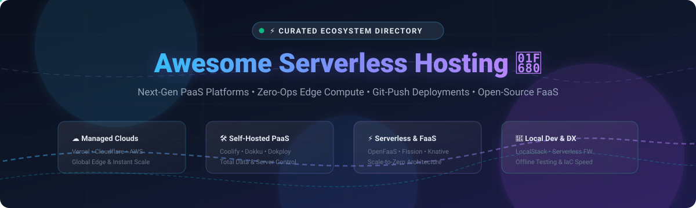

<p align="center">
  
</p>

# Awesome Serverless Hosting 🚀

[](https://awesome.re)
[](https://github.com/ishandutta2007/Awesome-Serverless-Hosting)
[](https://github.com/ishandutta2007/Awesome-Serverless-Hosting/pulls)
[](LICENSE)

> A curated list of top **Serverless Hosting**, **Platform-as-a-Service (PaaS)**, **Frontend Cloud**, and **Self-Hosted Open-Source Alternatives** to deploy apps, microservices, and static sites with modern Git-integrated workflows.

Whether you're looking for enterprise global edge CDNs like Vercel, Netlify, and Cloudflare Pages, zero-config full-stack cloud platforms like Render and Railway, or robust self-hosted alternatives like Coolify, Dokku, and OpenFaaS—this guide compiles everything you need to build, scale, and self-host modern web applications.

---

## 📑 Table of Contents
- [🌐 Sector Overview & Market Dynamics](#-sector-overview--market-dynamics)
- [☁️ SaaS & Managed Cloud Platforms](#️-saas--managed-cloud-platforms)
- [🛠️ Open-Source GitHub Projects](#️-open-source-github-projects)
  - [📦 Self-Hosted PaaS (Vercel & Heroku Alternatives)](#-self-hosted-paas-vercel--heroku-alternatives)
  - [⚡ Self-Hosted Serverless, FaaS & Edge Compute](#-self-hosted-serverless-faas--edge-compute)
  - [🧰 Developer Tooling, Frameworks & Local Emulators](#-developer-tooling-frameworks--local-emulators)
  - [🌱 Additional Emerging Open-Source Projects](#-additional-emerging-open-source-projects)
- [🧭 Decision Guide: Which Platform Should You Choose?](#-decision-guide-which-platform-should-you-choose)
- [🤝 How to Contribute](#-how-to-contribute)
- [⚖️ Disclaimer & License](#️-disclaimer--license)

---

## 🌐 Sector Overview & Market Dynamics

The global serverless architecture and cloud application hosting market is estimated at **$25.8 Billion in 2026** (projected to reach over **$65 Billion by 2031**, expanding at a ~21% CAGR).

The sector is **moderately fragmented with clear tier-1 concentration**: hyperscalers (Amazon AWS, Microsoft Azure, Google Cloud) capture the bulk of total enterprise backend spend, while specialized frontend clouds (Vercel, Cloudflare, Netlify) capture high-growth developer mindshare through superior developer experience (DX), edge compute primitives, and automated Git-push workflows. In parallel, a major self-hosting counter-movement led by tools like Coolify and Dokku is rapidly growing among teams prioritizing data privacy, predictability, and sovereign infrastructure.

---

## ☁️ SaaS & Managed Cloud Platforms

The table below outlines leading commercial serverless hosting and PaaS providers. It is ordered by **Company Scale (Valuation / Revenue) in descending order**:

| Provider 🏢 | Company Scale / Valuation 💰 | Starting Paid Tier 💳 | Free Tier Limit 🎁 | Best For 🎯 |
| :--- | :--- | :--- | :--- | :--- |
| **[AWS Amplify](https://aws.amazon.com/amplify/)** | **~$2.2T** *(Amazon parent cap; AWS ~$110B+ run-rate)* | **Pay-As-You-Go**: $0.01/build min, $0.023/GB stored, $0.15/GB served | **Free for 12 Months**: 1,000 build mins/month, 5 GB storage, 15 GB/mo served *(Always-free SSR compute: 500,000 req/mo &amp; 100 GB-hours)* | Deep AWS integration, full-stack React/Next/Vue apps requiring managed AWS backends |
| **[Firebase App Hosting](https://firebase.google.com/)** | **~$2.1T** *(Alphabet parent cap; GCP ~$45B+ run-rate)* | **Pay-As-You-Go (Blaze Plan)**: Cloud Run compute ($0.000024/vCPU-s, $0.0000025/GiB-s) + egress | **Spark Plan (Always Free)**: 10 GB hosting storage, 360 MB/day data transfer, 125,000 Cloud Run vCPU-seconds/mo | Full-stack Next.js/Angular SSR apps deeply integrated with Google Cloud &amp; Firestore |
| **[Oxygen (Shopify)](https://shopify.dev/docs/api/hydrogen/latest/oxygen)** | **~$130B** *(Shopify Market Cap; ~$9B+ rev)* | **$39/month** *(Included with Shopify Basic Plan)* | **3-Day Free Trial** *(plus $1/month promo for first 3 months)* with unlimited worker invocations on staging | Headless Shopify commerce storefronts built with Hydrogen &amp; Remix |
| **[Cloudflare Pages](https://pages.cloudflare.com/)** | **~$38B** *(Market Cap; ~$1.7B+ ARR)* | **$20/month** *(Workers Paid Tier with 10M requests included)* | **Always Free**: Unlimited total bandwidth, unlimited sites, 500 builds/month, 100,000 Worker invocations/day | Jamstack sites, full-stack edge applications, low-latency globally distributed apps |
| **[Heroku](https://www.heroku.com/)** | **~$290B** *(Salesforce parent; ~$1B estimated Heroku unit rev)* | **$5/month** *(Eco dynos with 1,000 dyno hours pool)* | **No Permanent Free Tier**: 30-Day Free Trial with 1,000 free dyno hours via Student/GitHub Student Developer Pack | Classic 12-factor apps, rapid prototyping, managed PostgreSQL/Redis add-on ecosystem |
| **[Vercel](https://vercel.com/)** | **~$3.25B** *(Latest Valuation; ~$150M+ ARR)* | **$20/month per member** *(Vercel Pro Plan)* | **Always Free (Hobby Tier)**: 100 GB bandwidth/month, 100 edge config reads/day, 1,000 image optimizations, personal projects only | Next.js, frontend frameworks, preview branch URLs, instant edge delivery |
| **[Netlify](https://www.netlify.com/)** | **~$2.0B** *(Valuation; ~$80M+ ARR)* | **$19/month per member** *(Pro Plan)* | **Always Free**: 100 GB bandwidth/month, 300 build minutes/month, 1 concurrent build, 125k edge function calls/month | Jamstack architectures, automated preview workflows, static-first websites |
| **[Fly.io](https://fly.io/)** | **~$700M** *(Valuation; ~$35M+ ARR)* | **$5/month** *(Hobby baseline fee + usage-based microVMs)* | **Always Free Allowance**: Up to 3 shared-cpu-1x 256MB microVMs, 3 GB persistent storage volume, 160 GB outbound bandwidth | Dockerized full-stack apps running close to users with Firecracker microVMs |
| **[Render](https://render.com/)** | **~$500M** *(Valuation; ~$25M+ ARR)* | **$7/month per service** *(Starter Web Service; Team plan $19/user)* | **Always Free**: 100 GB egress/month, 500 build minutes/month, 750 hours/mo for static sites &amp; spinning-down free web services | Unified cloud for full-stack apps, background workers, cron jobs, and managed Postgres |
| **[Railway](https://railway.app/)** | **~$350M** *(Valuation; ~$18M+ ARR)* | **$5/month base fee** *(Hobby tier includes $5 usage credits)* | **30-Day Free Trial** with $5 one-time credit or continuous free Starter plan limited to 512MB RAM &amp; $5/mo usage | Instant Git-to-cloud deployments, preview environments, fast developer DX |

---

## 🛠️ Open-Source GitHub Projects

Explore the most popular open-source serverless hosting engines, PaaS solutions, and FaaS platforms. Repositories are organized with real-time star badges linking to stargazers and sorted by **GitHub Star Count in descending order**:

### 📦 Self-Hosted PaaS (Vercel & Heroku Alternatives)

*Turn your VPS, bare-metal server, or private cloud into an automated deployment platform.*

- **[Coolify](https://github.com/coollabsio/coolify)** [](https://github.com/coollabsio/coolify/stargazers)  
  The leading self-hosted all-in-one PaaS and open-source alternative to Vercel, Netlify, and Heroku. Features an intuitive web UI, multi-server clustering, automated Let's Encrypt SSL, Docker Compose orchestration, and push-to-deploy workflows for GitHub, GitLab, and Gitea.

- **[Dokploy](https://github.com/Dokploy/dokploy)** [](https://github.com/Dokploy/dokploy/stargazers)  
  A modern, lightweight Docker Compose-first alternative to Vercel and Heroku. Comes with built-in Traefik reverse proxy, automated SSL certificates, multi-node capabilities, and database provisioning out of the box.

- **[Dokku](https://github.com/dokku/dokku)** [](https://github.com/dokku/dokku/stargazers)  
  The smallest PaaS implementation you've ever seen. Provides Heroku-compatible `git push` deployments powered by Docker and buildpacks, with minimal resource overhead (~1GB RAM) and a rich plugin ecosystem.

- **[CapRover](https://github.com/caprover/caprover)** [](https://github.com/caprover/caprover/stargazers)  
  Battle-tested Docker Swarm-powered PaaS for deploying web apps and databases across one or multiple clustered nodes without the complexity of Kubernetes.

---

### ⚡ Self-Hosted Serverless, FaaS & Edge Compute

*Deploy event-driven functions and microservices with automatic scaling down to zero.*

- **[OpenFaaS](https://github.com/openfaas/faas)** [](https://github.com/openfaas/faas/stargazers)  
  Serverless Functions Made Simple. Highly popular cloud-native framework that lets you turn any container into a serverless function on Kubernetes or Docker Swarm with auto-scaling and Prometheus observability.

- **[Fission](https://github.com/fission/fission)** [](https://github.com/fission/fission/stargazers)  
  Fast, Kubernetes-native serverless framework featuring ultra-fast ~100ms cold starts via warm container pooling. Supports NodeJS, Python, Go, and arbitrary Linux binaries.

- **[Apache OpenWhisk](https://github.com/apache/openwhisk)** [](https://github.com/apache/openwhisk/stargazers)  
  Open-source distributed serverless platform that executes functions in response to incoming events at any scale. The underlying engine behind IBM Cloud Functions.

- **[Knative Serving](https://github.com/knative/serving)** [](https://github.com/knative/serving/stargazers)  
  Kubernetes-based, request-driven compute runtime that provides scale-to-zero capabilities, traffic routing, revisions, and automated container deployment standards.

- **[Tau (Taubyte)](https://github.com/taubyte/tau)** [](https://github.com/taubyte/tau/stargazers)  
  Open-source Git-native WebAssembly (WASM) cloud platform. Transforms Git repositories into globally distributed serverless networks with built-in storage and edge compute.

- **[Juno](https://github.com/junobuild/juno)** [](https://github.com/junobuild/juno/stargazers)  
  Self-hosted serverless platform for static websites, authentication, data storage, and WebAssembly-based serverless functions—often termed *"Vercel + Firebase + Self-Hosting"*.

- **[Self-Hosted Serverless (Go)](https://github.com/mstgnz/self-hosted-serverless)** [](https://github.com/mstgnz/self-hosted-serverless/stargazers)  
  Lightweight alternative to AWS Lambda written in Go. Executes functions as Go plugins or WASM modules with built-in rate-limiting, metrics, and Redis/PostgreSQL support.

---

### 🧰 Developer Tooling, Frameworks & Local Emulators

*Accelerate your serverless development lifecycle and test locally before going to production.*

- **[LocalStack](https://github.com/localstack/localstack)** [](https://github.com/localstack/localstack/stargazers)  
  A fully functional local AWS cloud stack. Develop and test Lambda, S3, DynamoDB, API Gateway, and serverless applications completely offline without cloud billing.

- **[Serverless Framework](https://github.com/serverless/serverless)** [](https://github.com/serverless/serverless/stargazers)  
  The industry-standard open-source CLI framework for building and deploying auto-scaling web apps on AWS Lambda, Azure Functions, Google Cloud Functions, and more.

---

### 🌱 Additional Emerging Open-Source Projects

- **[Miabi](https://github.com/)** — Enterprise-ready self-hosted PaaS written in Go with Docker pipelines, marketplace templates, multi-cluster support, and SAML/SCIM SSO.
- **[Levelrail](https://github.com/)** — Modern Apache 2.0 self-hosted PaaS featuring automated health gates, blue-green cutovers, and Model Context Protocol (MCP) support for AI agents.

---

## 🧭 Decision Guide: Which Platform Should You Choose?

```
                       What is your deployment goal?
                                     │
         ┌───────────────────────────┴───────────────────────────┐
         ▼                                                       ▼
   [Managed Cloud SaaS]                                    [Self-Hosted / Open-Source]
         │                                                       │
  Frontend / Edge focus?                                  What is your infrastructure base?
  ├─► YES: Vercel / Cloudflare Pages / Netlify            ├─► Single VPS: Dokku / Dokploy
  └─► Full-stack Containers: Render / Railway / Fly.io    ├─► Multi-Server VPS: Coolify / CapRover
                                                          ├─► Kubernetes Cluster: OpenFaaS / Fission
                                                          └─► Local Development: LocalStack
```

---

## 🤝 How to Contribute

We love community contributions! To add a new platform or update existing details:

1. 🍴 **Fork** this repository.
2. 🌿 **Create a new branch** (`git checkout -b add-platform-name`).
3. 📝 **Add your entry** adhering to table format or alphabetical star order with verified pricing, free tier limits, and GitHub star badges.
4. 🚀 **Commit your changes** (`git commit -m "Add Awesome Platform"`).
5. 📤 **Push to your branch** (`git push origin add-platform-name`).
6. 🎯 **Open a Pull Request** with a brief summary of the project.

---

## ⚖️ Disclaimer & License

- This repository is a community-maintained curated directory and is not officially affiliated with or endorsed by any listed company.
- Pricing, free tiers, and feature limits are verified as of **October 2026** and may evolve over time.
- Licensed under the [Creative Commons Zero v1.0 Universal](LICENSE).
